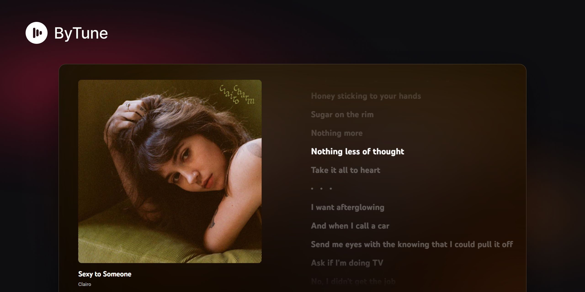

<p align="center"></p>

<h1 align="center">ByTune</h1>

<p align="center">
  A clean, fast desktop client for YouTube Music, with synced lyrics and a distraction-free fullscreen mode.
</p>

<p align="center">
  <a href="https://github.com/Jscruzgg/ByTune/releases/latest"></a>
  <a href="https://github.com/Jscruzgg/ByTune/releases"></a>
  
  <a href="LICENSE"></a>
</p>

<p align="center">
  <a href="https://github.com/Jscruzgg/ByTune/releases/latest"><b>Download for Windows</b></a>
</p>

---

ByTune opens [music.youtube.com](https://music.youtube.com) in its own window, signed in with your Google account, and reshapes it into a desktop app: synced lyrics, a fullscreen Now Playing view, a quick search menu, tray and taskbar controls, and a lighter, more focused theme. It is built with [Electron](https://www.electronjs.org) and keeps YouTube Music's own player, so your library, playlists and recommendations work as usual.

## Features

**Listening**
- **Synced lyrics**: line-by-line lyrics from [LRCLIB](https://lrclib.net) that follow the song, Apple Music style. Click a line to jump to it. When there are no synced lyrics, YouTube Music's plain lyrics are shown in the same style.
- **Fullscreen mode**: cover and lyrics only. The player controls fade away after a few seconds and come back when you move the pointer; touch the right edge for the queue and the left edge for the side menu.
- **Song / video toggle** in Now Playing.
- **Queue reordering** by drag and drop, in both the queue and autoplay.

**Look and feel**
- Custom theme: Spotify-style album and playlist pages, a centered search box, a player bar with the song on the left and the controls in the center, and an Apple Music-style Now Playing.
- Playlist covers in the sidebar, cached so they show instantly.
- Resizable sidebar and queue (drag their edge; double-click to reset).
- No Windows title bar: the app's top bar moves the window.
- The theme can be turned off from the tray or the settings menu.

**Windows integration**
- Tray icon with play/pause, next, previous and the current song. Closing the window keeps the app in the tray (optional).
- Previous / play-pause / next buttons in the taskbar preview.
- Keyboard media keys and the Windows media panel.
- Song change notifications and a *Start with Windows* option.
- Interface in English and Spanish.

**Quick menu and shortcuts**
- A quick menu (`Ctrl+Shift+Space` by default) to search songs, jump to your playlists and control playback, from inside the app or from anywhere.
- Global shortcuts for next, previous and show/hide (see below).

**Updates**
- The installed app updates itself from GitHub Releases on launch: a small notice while it downloads, then the new version installs silently over the current one and opens.

## Install

1. Download the latest version from **[Releases](https://github.com/Jscruzgg/ByTune/releases/latest)**:
   - `ByTune-Setup-x.y.z.exe`: installer, with shortcuts and an uninstaller. Updates itself.
   - `ByTune-x.y.z-portable.exe`: portable, no install needed. Does not update itself.
2. Run it. The app is not code-signed, so Windows SmartScreen may warn you: choose *More info → Run anyway*.
3. Sign in with your Google account inside the app. The session is remembered between restarts.

ByTune runs on Windows 10 and 11.

## Keyboard shortcuts

| Shortcut | Action |
|---|---|
| `Ctrl+Shift+Space` | Open the quick menu (configurable in settings) |
| `Ctrl+Alt+→` / `Ctrl+Alt+←` | Next / previous song (global) |
| `Ctrl+Alt+M` | Show / hide the window (global) |
| `Alt+↓` in the quick menu | Play / pause (`Alt+←` / `Alt+→`: previous / next) |
| `Alt+←` / `Alt+→` | Back / forward in the window |
| `F5` | Reload |
| `Ctrl +` / `Ctrl -` / `Ctrl 0` | Zoom in / out / reset |
| `Esc` | Exit fullscreen |

## Build from source

Requirements: Windows 10/11 and [Node.js](https://nodejs.org) 20 or later.

```bash
git clone https://github.com/Jscruzgg/ByTune.git
cd ByTune
npm install
npx --no install-electron --no
npm start
```

- `npx --no install-electron --no` downloads the Electron binary. Recent npm versions block install scripts, and without this step Electron does not start.
- `npm start` runs the app from the source code.
- `npm run dist` generates the icons and builds the installer and the portable version in `dist\`.
- `npm test` runs the unit tests.

### Project layout

| Path | What it does |
|---|---|
| `src/main.js` | Main process: window, tray, shortcuts, settings, updates, lyrics requests |
| `src/preload.js` | Runs inside the page: settings menu, back button, panel resizers, covers |
| `src/page-api.js`, `src/covers.js` | Injected into the page to use your YouTube Music session (library, search, lyrics) |
| `src/lyrics-view.js`, `src/lyrics.css` | Synced lyrics and fullscreen Now Playing |
| `src/queue-reorder.js` | Drag-and-drop queue reordering |
| `src/theme.css`, `src/chrome.css` | The theme and the draggable top bar |
| `src/quickmenu/` | The quick menu window |
| `src/lib/` | Small pure helpers, with unit tests in `test/` |
| `scripts/` | Icon generator, release script and developer tools |

### Developer tools

Start the app with a debugging port and drive it from the command line:

```bash
YTM_DEBUG_PORT=9222 npm start
node scripts/cdp.mjs css src/theme.css
```

- `node scripts/cdp.mjs css src/theme.css` reinjects the theme without restarting. Other commands: `shot`, `metrics`, `eval`, `click`.
- Layout checks: `overlaps` (player bar at several widths), `navcheck` (search box), `clipcheck` (clipped text).
- `node scripts/test-like.mjs` tests like / dislike with real clicks.
- `YTM_USER_DATA=<folder>` runs the app with a separate profile, so you can test next to an installed copy.

## Contributing

Contributions are welcome: bug reports, ideas and pull requests.

1. Fork the repository and create a branch from `main`.
2. Make your change and test it in the app (`npm start`). Run `npm test` before opening the pull request.
3. Open a pull request to `main` describing what changed and how you tested it.

Every pull request merged into `main` publishes a new release automatically (`.github/workflows/release.yml`). If the pull request didn't bump `version` in `package.json`, the workflow bumps the patch version.

Please keep the app light: prefer CSS over JavaScript in the page, animate only `transform` and `opacity`, and avoid `backdrop-filter`.

## Privacy

ByTune is a window around music.youtube.com: you sign in with Google on Google's own page, and your session stays on your computer. The app itself only talks to:
- **YouTube Music**, like any browser would;
- **LRCLIB**, to look up lyrics (it sends the song title, artist, album and duration);
- **GitHub Releases**, to check for updates.

There are no analytics and no accounts of its own.

## Credits

- Lyrics from [LRCLIB](https://lrclib.net), a free and open lyrics database.
- Built with [Electron](https://www.electronjs.org) and packaged with [electron-builder](https://www.electron.build).

## Disclaimer

ByTune is an independent project. It is not affiliated with, endorsed by or sponsored by Google or YouTube. YouTube Music is a trademark of Google LLC.

## License

[MIT](LICENSE) © 2026 Juan Cruz and ByTune contributors
